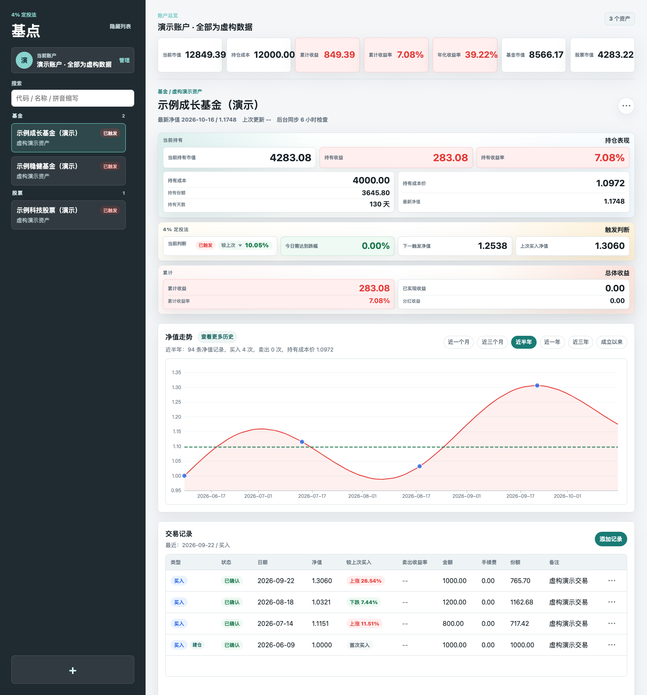

# 基点 · Jidian

**把每一次交易记清楚，让持仓与收益一目了然。**

基点是一款本地优先的基金与 A 股投资记录工具，将多账户资产、交易、分红与历史行情放在同一个工作台中，并提供可配置的跌幅定投参考。无需注册，投资记录保存在自己的设备上。

A local-first portfolio tracker for Chinese mutual funds and A-shares, with multi-account records, dividend tracking, charts, and DCA triggers.

[](https://github.com/VeejaLiu/jidian/releases/latest)
[](https://github.com/VeejaLiu/jidian/actions/workflows/ci.yml)
[](LICENSE)

[下载桌面版](https://github.com/VeejaLiu/jidian/releases/latest) · [更新记录](CHANGELOG.md) · [反馈问题](https://github.com/VeejaLiu/jidian/issues) · [开发与打包](docs/DEVELOPMENT.md)



> 截图使用独立的演示数据库，账户、资产、价格和交易均为虚构数据。安装包不包含演示记录或个人投资数据。

## 功能

| 功能 | 说明 |
| --- | --- |
| 多账户 | 分别管理账户与资产，汇总市值、持仓成本、累计收益及 XIRR 年化收益率 |
| 基金与 A 股 | 按代码添加资产，同步基金历史净值与沪深 A 股历史价格 |
| 交易记录 | 记录买入、卖出和手续费；基金净值尚未公布时先保存为待确认交易 |
| 分红与公司行为 | 现金分红、红利再投、送股、转增股本和股息红利税 |
| 图表分析 | 净值曲线、股票 K 线、买卖点与成本参考线 |
| 定投辅助 | 默认按上次买入净值下跌 4% 计算触发位置，可按账户中的基金调整阈值 |
| 批量导入 | 粘贴表格中的成交记录，支持中文表头 |
| 本地备份 | 导出、预览并导入整库 JSON 备份，包含账户、隐藏资产、交易和价格历史 |

隐藏资产会保留原有记录，可以随时恢复。自动行情同步依赖公开数据源，可能存在延迟或临时不可用。

## 下载与安装

前往 **[最新正式版本](https://github.com/VeejaLiu/jidian/releases/latest)**，下载 macOS 安装包。需要 **macOS 13（Ventura）或更新版本**：

| 文件 | 用途 |
| --- | --- |
| `jidian-1.0.0-macos-universal.dmg` | 推荐；同时支持 Apple Silicon（M 系列）和 Intel Mac |
| `jidian-1.0.0-macos-universal.zip` | 相同应用的 ZIP 压缩包 |
| `SHA256SUMS.txt` | 校验下载文件是否完整 |

打开 DMG，将「基点」拖入「应用程序」，然后启动。桌面版自带运行环境，无需安装 Node.js。

**v1.0.0 未使用 Apple Developer ID 签名，也未提交 Apple 公证。** macOS 可能拦截首次打开；确认文件来自本仓库并核对校验值后，可在「系统设置 → 隐私与安全性」中按系统提示允许打开。请以 Release 页面标明的签名状态为准。

在下载目录校验文件：

```bash
shasum -a 256 -c SHA256SUMS.txt
```

目前正式二进制发布面向 macOS。Windows 和 Linux 用户可以尝试从源码运行；本版本未提供这两个平台的安装包。

## 开始使用

1. 创建或选择账户，添加基金或股票。
2. 录入历史交易，也可以从「批量导入」粘贴成交表格。
3. 同步行情，查看持仓、收益、历史图表与定投触发位置。
4. 定期在账户管理中导出备份；迁移设备时先预览备份，再确认导入。

整库导入会替换当前数据库中的记录，并在本地备份目录保留导入前快照。操作前仍建议单独导出并妥善保存备份。

### 跌幅触发如何计算

```text
下一次触发净值 = 上次买入净值 ×（1 − 跌幅阈值）
```

例如，上次买入净值为 `1.0000`，阈值为 `4%`，触发净值就是 `0.9600`。这是记录与计算功能，不会自动下单。

## 从源码运行

需要 **Node.js 24**，推荐使用 [.nvmrc](.nvmrc) 中的版本。

```bash
git clone https://github.com/VeejaLiu/jidian.git
cd jidian
npm ci
npm run dev
```

打开 <http://127.0.0.1:4173/>。前端页面和 API 由同一个本地服务提供。

构建后运行：

```bash
npm run build
npm run serve
```

也可使用 Docker：

```bash
docker compose up --build -d
```

Docker 默认只向本机发布 `4173` 端口，并将数据库保存在仓库的 `data/` 目录。

## 数据与隐私

- **投资记录保存在本地 SQLite 文件中**，应用不要求登录，也不主动上传交易记录或整库备份。
- 行情同步会向东方财富、腾讯等公开行情服务发送资产代码和查询日期等请求；这些服务可以看到请求的网络信息。
- 服务默认只监听 `127.0.0.1`。本地 API 没有登录认证，请在个人可信设备上使用，不要直接暴露到公网。
- 数据库、JSON 备份和日志未由本应用加密，请自行管理设备权限和备份存储。反馈问题时请使用虚构数据。

| 运行方式 | 默认数据库位置 |
| --- | --- |
| 源码运行 / 桌面开发 | `data/fund-dca.sqlite` |
| macOS 已安装桌面版 | `~/Library/Application Support/jidian/fund-dca.sqlite` |

桌面版日志位于 `~/Library/Application Support/jidian/logs/`；自动快照位于相应数据目录的 `backups/`。卸载或迁移应用前，请先导出备份。

数据库、备份、环境变量和签名证书不属于开源仓库或安装包。CI 会检查常见私有文件和提交历史中的密钥；截图仍需人工核查。

## 开发

前端使用 React、TypeScript、Vite 与 ECharts；后端使用 Express 与 better-sqlite3；桌面端由 Electron 承载本地服务。

```text
src/          前端组件、交互与图表
server/       API、持仓计算、行情同步与数据库迁移
database/     SQLite 初始化结构
electron/     桌面入口与隔离构建脚本
scripts/      测试隔离与公开文件检查
tests/        交易、策略与备份测试
```

```bash
npm run typecheck
npm test
npm run check:public
npm run build
npm run build:server
```

测试自动使用临时数据库，并在完成后清理。桌面开发、安装包构建和原生模块排错见 [开发说明](docs/DEVELOPMENT.md)。参与贡献前请阅读 [贡献指南](CONTRIBUTING.md)；安全问题请参照 [安全政策](SECURITY.md) 私下报告。

## 许可与说明

本项目采用 [ISC 许可证](LICENSE)。基金净值、股票价格及相关资料的权利归原始数据提供方所有，使用时请遵守相应服务条款。

基点用于个人投资记录、计算与辅助参考，不提供投资建议。实际成交、确认份额、费用和税款以基金平台或证券机构记录为准。
